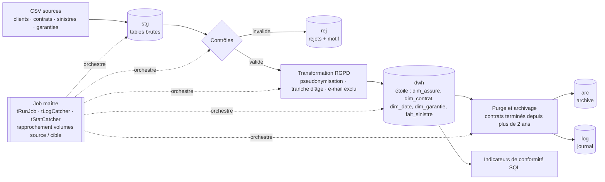

# next-talend — mini-chaîne de conformité en assurance non-vie

POC d'intégration de données construit avec **Talaxie Open Studio for Data Integration** (fork communautaire de Talend Open Studio) et **PostgreSQL** : de fichiers sources fictifs jusqu'à un datamart en étoile conforme RGPD, avec contrôles, rejets, pseudonymisation, purge/archivage et restitution d'indicateurs de conformité.

> Toutes les données sont **fictives** (générées par script, domaines e-mail réservés RFC 2606). Aucune donnée réelle.

## Chaîne cible



## Avancement

- [x] **0. Environnement** — JDK 21, PostgreSQL 17, Talaxie 8.9.0 ([détails](docs/environnement.md))
- [x] **0 bis. Onboarding Talend / ETL** — [tutoriel](docs/onboarding_talend.md) et exercice 0 (lecture de `clients.csv`)
- [x] **1. Données** — générateur Python avec défauts volontaires et oracle de tests
- [ ] 2. Staging — CSV → tables brutes PostgreSQL
- [ ] 3. Contrôles et rejets
- [ ] 4. Transformation RGPD (routine Java de hachage à clé secrète)
- [ ] 5. Chargement en étoile
- [ ] 6. Purge et archivage
- [ ] 7. Orchestration et rapprochement
- [ ] 8. Restitution (indicateurs de conformité)

## Démarrage rapide

```powershell
copy .env.example .env                    # puis renseigner PGPASSWORD (jamais committé)
python data\generate_dataset.py           # écrit data\generated\ (ignoré par git)
.\scripts\launch-studio.ps1               # Talaxie sur le workspace talend-workspace\
```

Python 3.14 (testé ; ≥ 3.9 attendu), **bibliothèque standard uniquement** (pas de `pip install`).

## Le jeu de données

`python data/generate_dataset.py [--seed 42] [--ref-date 2026-10-01]` produit **10 142 lignes** : UTF-8, séparateur `;`, dates `yyyy-MM-dd`, décimale `.`.

| Fichier | Lignes | Acceptées | Rejetées | Défauts injectés (motif → volume) |
|---|---:|---:|---:|---|
| `clients.csv` | 3 060 | 2 800 | 260 | `CHAMP_OBLIGATOIRE_VIDE` 70 · `EMAIL_INVALIDE` 90 · `DATE_INVALIDE` 40 · `DOUBLON` 60 |
| `contrats.csv` | 4 540 | 4 360 | 180 | `CHAMP_OBLIGATOIRE_VIDE` 50 · `REF_CLIENT_INCONNU` 40 · `DATES_INCOHERENTES` 30 · `DATE_FIN_ABSENTE` 20 · `DOUBLON` 40 |
| `sinistres.csv` | 2 530 | 2 340 | 190 | `CHAMP_OBLIGATOIRE_VIDE` 35 · `REF_CONTRAT_INCONNU` 30 · `REF_GARANTIE_INCONNUE` 25 · `DATES_INCOHERENTES` 25 · `HORS_PERIODE_GARANTIE` 25 · `MONTANT_NEGATIF` 20 · `DOUBLON` 30 |
| `garanties.csv` | 12 | 12 | 0 | référentiel |

Au-delà des rejets, le jeu contient volontairement :

- **811 contrats à purger** — terminés avant le 2024-10-01 (seuil *strict* : `date_fin < ref_date − 2 ans`) — et leurs 472 sinistres, dont des cas **limites** (pile 2 ans = conservé : 6 contrats ; 2 ans + 1 jour = purgé : 7 contrats) ;
- **100 clients valides mais « sales »** (espaces parasites) qui ne doivent **pas** être rejetés — test de la normalisation (trim) ;
- **299 clients sans e-mail**, légitime puisque le champ est facultatif — test qu'on ne rejette que les e-mails *invalides*.

### Choix de conception

- **Un seul défaut par ligne** : les volumes de rejets attendus sont exacts, donc vérifiables.
- **Pas de rejet en cascade** : aucun contrat n'est rattaché à un client rejeté. La politique de cascade (rejeter les enfants d'un parent rejeté ?) reste une décision de conception à traiter explicitement dans le job.
- **Date de référence en paramètre** (`--ref-date`, puis variable de contexte `ref_date` dans Talend), jamais `now()` : jobs rejouables et tests déterministes.
- **Oracle de tests** : `expected_rejects.csv` (fichier, rang de ligne, clé, motif) et `expected_results.json` (volumes attendus, règles, empreintes SHA-256). Le générateur rejoue lui-même ses règles avec une implémentation indépendante et échoue si elles ne retrouvent pas exactement les défauts injectés.
- **Reproductible** : même `--seed` et même `--ref-date` ⇒ fichiers identiques à l'octet près.

### Règles de contrôle (référence pour les jobs)

Normalisation : `trim` de toutes les colonnes avant tout contrôle ; une valeur blanche équivaut à vide. Ordre : obligatoires → formats/cohérence → référentiel → période/montant → doublon (le 1er motif en échec gagne ; la 1re occurrence d'un doublon est conservée).

| Fichier | Règles |
|---|---|
| clients | `client_id`, `nom`, `prenom`, `date_naissance` obligatoires · `date_naissance` ISO valide entre `ref_date − 120 ans` et `ref_date` · `email` facultatif mais valide s'il est renseigné · doublon sur `client_id` |
| contrats | `contrat_id`, `client_id`, `produit`, `date_effet`, `statut` obligatoires · `client_id` ∈ clients acceptés · `date_fin ≥ date_effet` · `statut ≠ ACTIF` ⇒ `date_fin` obligatoire · doublon sur `contrat_id` |
| sinistres | `sinistre_id`, `contrat_id`, `garantie_code`, `date_survenance`, `date_declaration` obligatoires · `contrat_id` ∈ contrats acceptés · `garantie_code` ∈ référentiel · `date_declaration ≥ date_survenance` · survenance dans la période de garantie du contrat · `montant_regle ≥ 0` · doublon sur `sinistre_id` |

## Structure du dépôt

```
data/generate_dataset.py     générateur du jeu fictif + oracle
docs/environnement.md        installation et versions
docs/onboarding_talend.md    onboarding Talend / ETL, bonnes pratiques, questions d'entretien
scripts/launch-studio.ps1    lance Talaxie sur talend-workspace/
talend-workspace/            projet Talend (jobs versionnés)
```
