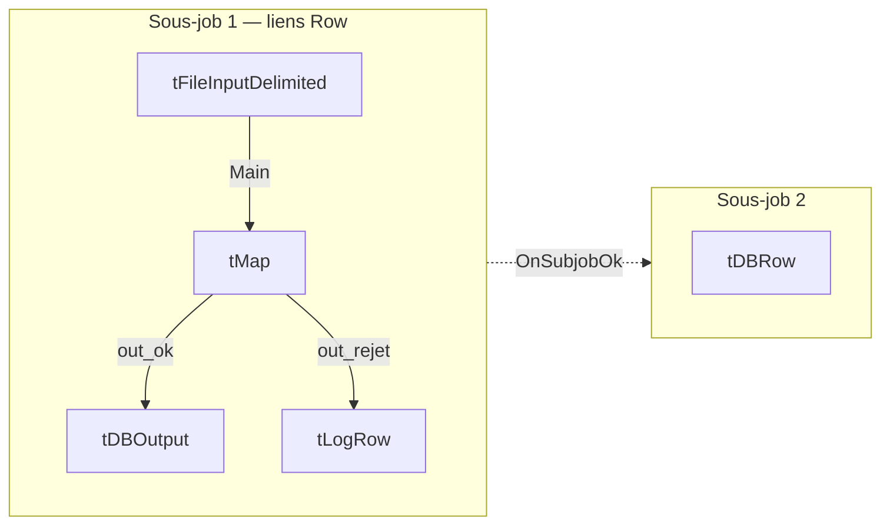

# Onboarding Talend / Talaxie — pour un data analyst SQL + Python

Hypothèses : tu n'as jamais ouvert un ETL, mais SQL, Python et PostgreSQL sont acquis. Ce document donne le **modèle mental**, le **vocabulaire d'entretien** et la **carte des composants** du POC ; le reste s'apprend en construisant. Durée de lecture : ~20 min. Le premier exercice est en [partie 6](#6-exercice-0--lire-clientscsv-30-min).

> L'IDE est partiellement traduit en français. Je donne le terme anglais (celui qu'on emploie en entretien) puis, quand je l'ai vérifié dans l'IDE, le libellé français : *Exécuter, Statistiques, Traces, Contexte, Arguments JVM, Paramètres avancés, Problèmes*.

---

## 0. Démarrer : connexion et projet (10 min)

Sur l'écran de connexion de Talaxie :

1. **Crayon ✎** à droite de la liste « Connexion » → ajouter une connexion **locale** (nom `local-dev`, dépôt *Local*). L'e-mail utilisateur demandé est **écrit dans les fichiers du projet, que ce dépôt public versionne** : mets une adresse fictive (`poc@example.com`), pas la tienne. Ignore « Switch sign in » (connexion cloud Qlik, inutile ici).
2. Sélectionne la connexion → **Créer un projet** → nom `NEXT_TALEND` (majuscules, chiffres, `_`) → *Terminer* → **Ouvrir**.
3. Si l'IDE propose d'installer des **bibliothèques / modules externes** (licences, JAR manquants), accepte : c'est normal, il faut Internet. Le **driver JDBC PostgreSQL** passera par là.
4. Ferme l'onglet d'accueil. Tu dois voir à gauche le *Repository*, au centre un canevas vide, à droite la *Palette*.

Le projet est créé dans `talend-workspace/NEXT_TALEND/` : c'est lui qui sera versionné.

---

## 1. Le modèle mental d'un ETL

**ETL = Extract, Transform, Load.** Tu déplaces et transformes des données entre systèmes, de façon répétable, traçable et exploitable par une équipe. **ELT** : on charge d'abord, on transforme *dans la base* en SQL. Talend sait faire les deux.

Trois idées à intégrer vite :

- **Moteur de flux ligne par ligne.** Les données circulent en *streaming* d'un composant à l'autre, en mémoire dans une JVM. C'est l'inverse du SQL (ensembliste) et proche d'un `for row in rows` Python. Conséquence : ce qui est massif (grosses jointures, agrégats) se *pousse dans la base* ; ce qui est règle métier ligne à ligne avec rejets se fait dans Talend. Sur 10 000 lignes, les deux marchent : le choix est *argumenté*, c'est ce qu'on te demandera.
- **Talend est un générateur de code.** Chaque *Job* devient une classe Java, compilée. Onglet **Code** sous le canevas : lis-le, c'est le meilleur outil pour comprendre. *Build Job* produit un ZIP autonome (`.bat`/`.sh`) qui s'exécute **sans Studio**, avec ses paramètres de contexte en ligne de commande. En entreprise, un ordonnanceur (TAC/TMC) lance ces builds ; ici, le Planificateur de tâches Windows ferait l'affaire.
- **Le job est le contrat.** Un ETL se justifie par la traçabilité (le schéma *est* la documentation), les composants standard (connexions, journaux, statistiques), les contextes par environnement et l'exploitation par d'autres que l'auteur.

**« Pourquoi Talend plutôt qu'un script Python ? »** — Lineage visuel et documentation vivante, composants et journalisation standards, contextes DEV/REC/PROD, exploitation par une équipe pas forcément développeuse. Contreparties honnêtes : jointures en mémoire (tMap) à surveiller, diffs XML illisibles, tests unitaires moins naturels.

---

## 2. Anatomie d'un job : vocabulaire à maîtriser



| Terme | Ce que c'est | Équivalent mental |
|---|---|---|
| **Job** (*Job Design*) | Un flux exécutable, une classe Java générée | un script |
| **Composant** (`tXxx`) | Une brique : lire, transformer, écrire… | une fonction |
| **Schéma** (*schema*) | Colonnes typées qui circulent sur un lien | le `dtype` d'un DataFrame |
| **Lien Row** (*Main, Lookup, Reject, Filter, Uniques/Duplicates*) | Fait **circuler des lignes** entre composants | un itérateur |
| **Lien Trigger** (*OnSubjobOk/Error, OnComponentOk/Error, Run if*) | Fait **enchaîner des exécutions**, sans données | `if ok: next_step()` |
| **Sous-job** (*subjob*) | Groupe de composants reliés par des liens Row, entouré d'un cadre coloré | un bloc |
| **Prejob / Postjob** | S'exécutent avant / après tout le reste du job (initialisation, fermeture des connexions) | `setup` / `teardown` |
| **Contexte** (*context*) | Variables par environnement : `context.db_host` | `.env` / config |
| **globalMap** | Dictionnaire partagé du job. Les composants y publient `<nom>_NB_LINE`, `<nom>_ERROR_MESSAGE` | variable globale |
| **Routine** | Classe Java statique réutilisable (*Code → Routines*) | un module utilitaire |
| **Métadonnées** (*Metadata*) | Connexions et schémas définis **une fois** dans le Repository, réutilisés partout | une config centrale |
| **Joblet** | Morceau de job réutilisable, *injecté* dans le job parent à la génération | une macro |
| **tRunJob** | Appelle un autre job (contexte passé en paramètre) | `subprocess` |

**Deux pièges qui font gagner une journée**

1. Les liens Row ne s'attendent pas : les composants d'un même sous-job tournent **en parallèle sur le flux** (comme un pipeline). Pour imposer un **ordre**, il faut un lien *Trigger*.
2. Le contexte et le `globalMap` se lisent en Java : `context.ref_date`, `(Integer) globalMap.get("tFileInputDelimited_1_NB_LINE")`. Dans les champs de code, `Ctrl+Espace` complète.

### Le composant roi : tMap

Un `tMap` reçoit **1 flux principal + N lookups** (jointures en mémoire) et produit **N sorties**, chacune avec son filtre et ses expressions. Il fait en une fois : jointure, filtre, calcul, aiguillage, **rejets** (*Catch output reject*, *Catch lookup inner join reject*). Tu peux y définir des **variables** intermédiaires. Les expressions sont du **Java** :

```java
row1.nom == null ? null : row1.nom.trim()          // null-safe, jamais row1.nom.trim() seul
StringHandling.TRIM(row1.email)                     // routine système Talend
TalendDate.parseDate("yyyy-MM-dd", row1.date_naiss) // lève une exception si invalide
Relational.ISNULL(row1.client_id)
```

Rappels Java pour un pythonien : comparer des chaînes avec `.equals()` (pas `==`), `null` ≠ chaîne vide, les types sont stricts (`Integer`, `Date`, `BigDecimal`).

### Types et schémas

Chaque colonne a un **type Talend** (`String`, `Integer`, `Date` + *pattern* `yyyy-MM-dd`, `BigDecimal`…) et un drapeau **Nullable**. Règle de **staging** : tout en `String`, on convertit et on contrôle *après*, sinon une date invalide fait planter la lecture au lieu d'alimenter la table de rejets.

---

## 3. Tour de l'IDE (5 min)

| Zone | Contenu | À savoir |
|---|---|---|
| **Repository** (gauche) | *Job Designs*, *Contexts*, *Code → Routines*, *Metadata* (connexions BD, fichiers délimités…) | Tout ce qui est réutilisable vit ici |
| **Palette** (droite) | Les composants, par famille (*Databases, File, Processing, Orchestration, Logs & Errors*…) | Clic sur le canevas vide puis taper le nom du composant : plus rapide |
| **Canevas** (centre) | Onglets **Designer** et **Code** | *Code* = le Java généré |
| **Component** (bas) | *Paramètres simples*, *Paramètres avancés*, *Vue* (libellé), *Documentation* | Tu y passes 80 % du temps |
| **Run** (bas) | **Exécuter** (`F6`), **Statistiques**, **Traces**, **Contexte**, **Arguments JVM**, mode Debug | Sélectionne le contexte avant de lancer |
| **Problèmes / Modules** (bas) | Erreurs de compilation / JAR requis | « Modules » = dépendances Java manquantes |

Gestes utiles : clic droit sur un composant → **Row → Main** puis clic sur la cible ; clic droit → **Trigger** pour l'ordre ; double-clic sur un `tMap` ouvre son éditeur ; *Schéma → Sync columns* propage un schéma.

---

## 4. Les composants du POC, étape par étape

| Étape | Composants clés | Notion à retenir |
|---|---|---|
| **0. Lecture** | `tFileInputDelimited`, `tLogRow` | Métadonnée fichier, schéma, encodage, compteur de lignes |
| **2. Staging** | `tDBConnection`, `tDBOutput`, `tDBCommit`/`tDBClose`, `tPrejob` | Connexion partagée, *Action on table* (Truncate), commit, `run_id` |
| **3. Contrôles / rejets** | `tMap`, `tSchemaComplianceCheck`, `tUniqRow`, `tFilterRow`, `tUnite` | Rejets avec motif, lookups de référentiel, 1er motif en échec |
| **4. RGPD** | **Routine Java** (HMAC-SHA256 clé secrète), `tMap` | Pseudonymisation ≠ anonymisation, minimisation (e-mail exclu), clé hors du dépôt |
| **5. Étoile** | `tMap` (lookups de clés de substitution), `tDBOutput` (*Insert or update*) | Dimensions, faits, clés techniques, rechargement idempotent |
| **6. Purge / archivage** | `tDBRow` (SQL en transaction), `tDBOutput` | Archive puis suppression **atomiques**, journal, date de référence en paramètre |
| **7. Orchestration** | `tRunJob`, `tLogCatcher`, `tStatCatcher`, `tDie`/`tWarn`, `tFlowMeter`+`tFlowMeterCatcher` | Job maître, propagation d'erreur, rapprochement des volumes |
| **8. Restitution** | SQL (vues) | Indicateurs lisibles par Power BI |

`tLogCatcher` capte les `tWarn`/`tDie` et les exceptions ; `tStatCatcher` capte durée et nombre de lignes par composant (case *tStatCatcher Statistics* à cocher) ; `tFlowMeter` compte les lignes d'un lien. Dans les **Project Settings → Job Settings → Stats & Logs**, tout peut être écrit en base de façon centralisée.

---

## 5. Bonnes pratiques attendues en entreprise

Ce sont des missions du poste (« normes de développement et bonnes pratiques ») : à appliquer dès le premier job.

- **Contextes par environnement.** Groupes `DEV` / `REC` / `PROD` ; **aucune valeur en dur** (hôte, base, chemins, `ref_date`). Les mots de passe et la clé de hachage viennent d'un fichier de contexte **hors dépôt**. Le même build est promu d'un environnement à l'autre.
- **Nommage.**
  - Jobs : `j_<NN>_<zone>_<verbe>_<objet>` → `j_02_stg_load_clients` ; maître : `j_00_master_run_chain`.
  - Composants : libellé parlant → `in_clients_csv`, `map_check_clients`, `out_rej_clients`.
  - Variables de contexte en `snake_case` : `db_host`, `ref_date`, `run_id`.
  - Base : schémas `stg`, `rej`, `dwh`, `arc`, `log`.
  - Repository classé en dossiers par étape.
- **Rejets.** Rien ne disparaît en silence : chaque rejet est écrit avec **motif, fichier, rang de ligne, clé métier, `run_id`**. Équation de contrôle : `lues = chargées + rejetées`.
- **Idempotence.** Relancer un job ne doit ni dupliquer ni corrompre : staging vidé puis rechargé par run, *upsert* (`ON CONFLICT`) dans le DWH, purge dans **une seule transaction**, aucune dépendance à `now()` (la date de référence est un paramètre).
- **Transactions et erreurs.** `tDBConnection` partagée + `tDBCommit` / rollback sur *OnSubjobError* ; `tDie` avec **code de sortie** pour que l'ordonnanceur voie l'échec.
- **Performance.** Chargement en lot (taille de lot, *commit every*, ou `COPY`) plutôt que ligne par ligne ; lookups volumineux : option *Store temp data* ; transformations massives poussées en SQL.
- **Tests.** Jeu de données de référence + **oracle** (`expected_rejects.csv`, `expected_results.json`) comparé à la table de rejets ; rapprochement de volumes dans le job maître ; cas limites volontaires (pile 2 ans).
- **Documentation.** Le champ *Description* de chaque job et de chaque composant clé, un README par étape : « documents de référence » est une mission du poste.
- **Versionnage.** Le projet Talend est versionné (XML) ; commits petits et nommés par étape ; secrets jamais committés.

---

## 6. Exercice 0 : lire `clients.csv` (30 min)

But : prendre en main l'IDE sans toucher à la base.

1. Génère les données si ce n'est pas fait : `python data\generate_dataset.py`.
2. **Metadata → File delimited → Create file delimited** → fichier `data/generated/clients.csv` ; séparateur **point-virgule**, encodage **UTF-8**, **1 ligne d'en-tête** ; mets **toutes les colonnes en `String`** (principe de staging). Nomme-la `file_clients_csv`.
3. Nouveau job **`j_00_hello_clients`**. Glisse la métadonnée sur le canevas → *tFileInputDelimited*. Ajoute un `tLogRow` en **mode Table**, relie-les par un lien **Row → Main**.
4. **Exécuter** (`F6`). Résultat attendu : **3 060 lignes** lues, `Chloé` et `Élodie` avec leurs accents.

À observer et à me rapporter :

- Dans **Statistiques**, le débit (lignes/s) et le nombre de lignes sur le lien.
- Dans l'onglet **Code**, retrouve la classe générée et le code qui lit le fichier.
- Change l'encodage en `ISO-8859-1` : qu'arrive-t-il à `Chloé` ? (Un classique : c'est le défaut n°1 des fichiers d'échange.)
- Dans le `tFileInputDelimited`, repère **Die on error** (*Paramètres simples*) ainsi que **Trim all columns** et **Check each row structure against schema** (*Paramètres avancés*). Que faut-il changer, et quel lien ajouter, pour que les lignes mal formées partent sur un lien **Reject** plutôt que d'arrêter le job ?
- Dans les 100 clients « sales », retrouve un nom avec espaces parasites : il doit apparaître tel quel tant qu'aucun trim n'est appliqué.

Quand c'est fait, montre-moi la capture (ou l'erreur) et on passe à l'étape 2, la base.

---

## 7. Questions d'entretien à savoir traiter

| Question | Éléments de réponse |
|---|---|
| **tMap ou tJoin ?** | `tMap` : plusieurs lookups, filtres, expressions et rejets dans un seul composant ; lookups en mémoire. `tJoin` : jointure simple 2 flux. |
| **Sous-job, tRunJob, joblet ?** | Sous-job : même job, même JVM, ordonné par triggers. `tRunJob` : appelle un autre job, contexte transmis, option de processus indépendant. Joblet : morceau réutilisable injecté dans le parent. |
| **Comment gérez-vous les rejets ?** | Un flux de rejet par contrôle, persisté avec motif, rang, clé, `run_id` ; équation de rapprochement ; politique explicite pour les enfants d'un parent rejeté. |
| **Comment rendre un job rejouable ?** | `run_id`, staging rechargé, *upsert*, purge transactionnelle, date de référence en paramètre. |
| **Comment passer de DEV à PROD ?** | Groupes de contextes ; même build, paramètres externes ; aucune valeur en dur ; secrets hors job. |
| **Comment tester ?** | Jeu de référence + oracle, rapprochement de volumes, cas limites, `tAssert`/`tAssertCatcher` (les *test cases* intégrés avec fixtures sont, à ma connaissance, réservés aux éditions commerciales). |
| **Performance ?** | Streaming, chargement en lot, poussée en SQL, lookups volumineux sur disque, parallélisation maîtrisée. |
| **Pseudonymisation vs anonymisation ?** | Pseudonymisation = réversible avec la clé, donc **toujours une donnée personnelle** au sens RGPD ; anonymisation = irréversible, hors champ. D'où clé secrète séparée, tranche d'âge et e-mail exclu (minimisation). |
